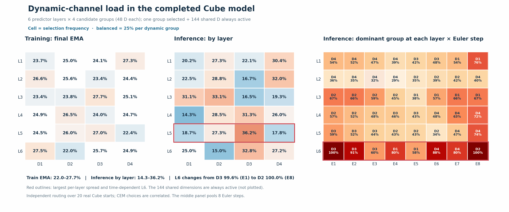

# Channelwise Flow-JEPA for Cube

This directory contains the **336 total / 192 active** channelwise predictor used
in the Cube experiment. It is a runnable copy of the model, training, inference,
evaluation, route probe, and latency benchmark. It does not contain checkpoints
or data. The repository root retains the original Flow-JEPA baseline.

## Mechanism

The visual latent is 192-dimensional. The predictor's residual state has seven
48-dimensional groups: three shared groups (144 dimensions) and four dynamic
candidate groups. For each candidate trajectory, predictor block, and Euler
evaluation, a router chooses one dynamic group. The active width is therefore
`144 + 48 = 192`; total available width is `144 + 4*48 = 336`.

The selected 192-coordinate submatrices are used by AdaLN, self attention,
cross attention, and the MLP. Unselected residual coordinates keep their
previous values and can be selected in another block or Euler step. The final
readout also uses only the last block's selected coordinates. The input,
context, and time projections still produce the 336-dimensional state.

The router reads the current future-state summary, visible context, visible
history change, action summary, and flow time. Training retains Flow-JEPA's
velocity MSE and SIGReg. The first 100 optimizer steps use random selection;
thereafter a bounded usage bias balances the four groups. Every eight steps,
a matched selected/unselected swap supplies an additional router ranking loss
with weight 0.01. The exact settings are in
[`config/train/routing/sparse336_active192.yaml`](config/train/routing/sparse336_active192.yaml).

The swap probe runs on one predictor layer every eight optimizer steps. It now
cycles through layers 1-6; `train/credit_probe_layer` records the selected
layer (0 on steps without a probe). The reported epoch-20 checkpoint and task
scores below predate this correction: its ordinary prediction loss updated all
six layers, while swap-probe supervision could repeatedly target one layer.
The corrected training schedule has passed a six-layer synthetic check but has
not been retrained or reevaluated on Cube.

## Run

Use Python 3.10 with a compatible CUDA PyTorch installation and install
[`requirements.txt`](requirements.txt). From this directory, choose a data root
and prepare the public Cube dataset with its recorded checksum:

```bash
export DATA_ROOT=/path/to/data
bash prepare_cube.sh
export STABLEWM_HOME="$DATA_ROOT"
export LOCAL_DATASET_DIR="$DATA_ROOT"
python train.py data=ogb +routing=sparse336_active192 \
  trainer.max_epochs=20 trainer.devices=4 loader.batch_size=32 \
  +trainer.strategy=ddp_find_unused_parameters_true \
  flow_matching.source=standard_noise loss.sigreg.weight=0.1
```

The model checkpoint is loaded with its adjacent `config.json`. Evaluate the
default, **independent candidate route** on 50 Cube starts with:

```bash
python eval.py --config-name=cube \
  policy=/path/to/weights_epoch_20.pt cache_dir=/path/to/data \
  eval.num_eval=50 seed=42 flow_seed=42 output.save_video=false
```

Append `perturbation.enabled=true` for the Gaussian condition. For the optional
shared candidate route, append
`sparse_share_route=true cuda_graph_predictor=true`. That option chooses one
route per block and Euler step using mean candidate features; it changes the
inference algorithm but not the checkpoint.

To collect route frequencies during ordinary Cube evaluation, set
`ROUTE_PROBE_OUTPUT=/path/to/route_report.json` and run
`python probe_routes_eval.py --config-name=cube` with the same evaluation
arguments. To benchmark a checkpoint on one GPU, run
`python benchmark_final_checkpoint_latency.py --checkpoint /path/to/weights_epoch_20.pt`.
The benchmark measures the predictor's eight Euler calls for 300 CEM
candidates, rather than an entire environment episode.

## Measured results

The 20-epoch checkpoint used 4 GPUs, global batch 128, and seed 3072. Task
evaluation used 50 Cube starts, CEM with 300 samples / 30 iterations / top 30,
eight Euler steps, and seed 42.

| Model and inference route | Clean | Gaussian |
| --- | ---: | ---: |
| Original 192-D Flow-JEPA, historical reference | 28/50 | 18/50 |
| Channelwise, independent route | **34/50** | **21/50** |
| Same channelwise checkpoint, shared route | **34/50** | **22/50** |

The original checkpoint is a historical single-run reference; it was not
retrained with the same fully seeded protocol. The task scores therefore do
not isolate the effect of learned routing from added capacity or run variation.

Total parameters are 23.03M for original Flow-JEPA and 39.50M for channelwise;
the channelwise model uses approximately 24.66M parameter values along one
selected candidate path. Both have 192 active predictor coordinates, but the
channelwise model retains a 336-dimensional state and performs routing.

| Predictor mode | RTX 4090 BF16 CUDA graph latency, 300 candidates x 8 Euler |
| --- | ---: |
| Original 192-D architecture, random weights | 12.77 ms |
| Channelwise, independent route, final checkpoint | 22.23 ms |
| Channelwise, shared route, same checkpoint | 16.17 ms |

The original latency uses architecture-identical random weights; the same
device, precision, and input shapes were used. These are predictor-only
measurements. See [`results/cube.json`](results/cube.json) for machine-readable
figures.

## Route load



The heatmap is **selection frequency**, not feature activation magnitude.
Shared dimensions are always active and omitted. Final training usage EMA
spans 22.0%-27.7% across layer/group cells. In inference, layer-aggregated
frequencies span 14.3%-36.2%; no dynamic group is globally unused. Routing is
more concentrated conditional on Euler step: layer 6 chooses dynamic group 3
on 99.6% of first-step candidates, then group 2 on 100% of eighth-step
candidates. These figures use 20 real Cube starts; the many CEM candidate
decisions are correlated, not independent task episodes.

The underlying [`route_probe.json`](figures/route_probe.json), derived
[`route_balance_stats.json`](figures/route_balance_stats.json), and plotting
[`plot_route_balance.py`](figures/plot_route_balance.py) are included.

## Source

This work extends [Flow-JEPA](https://github.com/HuoYanchen/Flow-JEPA), using
its model and Cube evaluation protocol. The original source revision for the
baseline is `ab73e7c50435e3a1fffb4d3f6d175445e57a2f4e`. See the repository
license for the inherited source.

